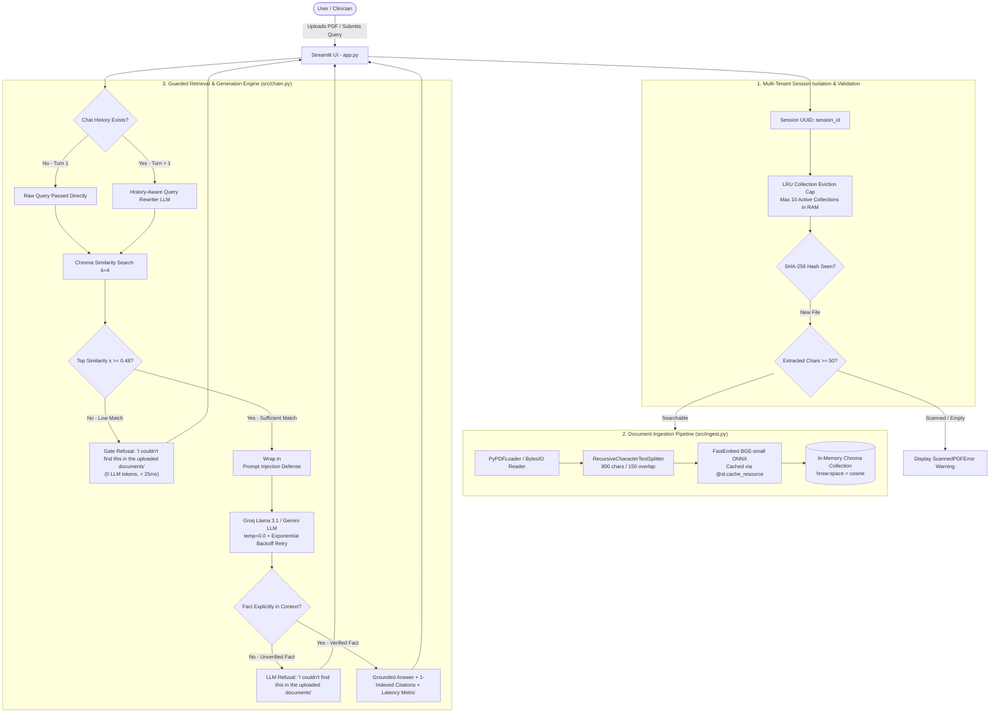

# ClinicDocs AI: Chat with Your Documents

[](https://www.python.org/)
[](https://python.langchain.com/)
[](https://www.trychroma.com/)
[](https://qdrant.github.io/fastembed/)
[](https://streamlit.io/)
[](LICENSE)

> **A production-grade, privacy-first Conversational RAG web application that turns static clinic policies, operating hours, and patient guidelines into grounded answers with 1-indexed page citations and two-layer refusal guardrails.**

---

## 🌐 Live Demo & Repository
- **Live Web Application**: [https://clinicdocs-ai.streamlit.app](https://clinicdocs-ai.streamlit.app)
- **GitHub Repository**: [https://github.com/farwanasir2810-collab/clinicdocs-ai](https://github.com/farwanasir2810-collab/clinicdocs-ai)

---

## 📸 Application Preview
```
+----------------------------------------------------------------------------------------------------+
| 🩺 ClinicDocs AI: Chat with Your Documents                                                         |
| Ask factual questions about your uploaded clinic policies, diagnostic turnaround times, and fees. |
|                                                                                                    |
| [User]: What are the clinic operating hours on Friday?                                             |
|                                                                                                    |
| [ClinicDocs AI]:                                                                                   |
| On Friday, Noor Care Clinic operates in two shifts:                                                |
| - Morning: 9:00 AM – 1:00 PM                                                                       |
| - Evening: 3:00 PM – 8:00 PM                                                                       |
| The clinic is closed between 1:00 PM and 3:00 PM for Friday prayers.                               |
|                                                                                                    |
| ⏱️ Response time: 0.84s                                                                            |
|                                                                                                    |
| ▼ 📄 View Source Citations (1)                                                                     |
|    Citation 1: Noor_Care_Clinic_FAQ.pdf — Page 1 (Match: 72.5%)                                    |
|    "Friday: 9:00 AM – 1:00 PM & 3:00 PM – 8:00 PM | General OPD & Diagnostics..."                 |
+----------------------------------------------------------------------------------------------------+
```

---

## 🎯 Key Features

1. **Strictly Grounded Answers with Citations**: Never hallucinates clinical protocols. Cites physical document names and exact **1-indexed page numbers** (`page_number = page + 1`) alongside match similarity.
2. **Two-Layer Refusal Guardrails**:
   - **Layer 1 (The Similarity Gate)**: Queries with semantic similarity below calibrated threshold ($s < 0.48$) are instantly refused with **0 LLM tokens used and < 25ms response time**.
   - **Layer 2 (LLM Context Grounding)**: Near-topic questions that pass the gate but lack grounding in the document context are refused by the prompt: *"I couldn't find this in the uploaded documents."*
3. **Multi-Tenant Ephemeral Session Isolation**: Vector collections live exclusively in process memory (`chromadb.EphemeralClient()`) keyed by unique session UUIDs. User documents are mathematically separated and deleted on session reset.
4. **Conditional Query Reformulation**: Turns follow-up questions (e.g., *"What about for a specialist?"*) into standalone search queries using conversation history. Bypasses the rewriter on Turn 1 to eliminate unnecessary latency.
5. **Ultra-Lightweight ONNX Embeddings**: Powered by **FastEmbed** (`BAAI/bge-small-en-v1.5`) running purely on ONNX runtime (no heavy PyTorch download, 2.2s cold start, ~136MB RAM).
6. **Input Validation & Safety**:
   - Detects scanned/image-only PDFs via text-density checks and raises `ScannedPDFError`.
   - Prevents duplicate re-indexing using SHA-256 byte hashing.
   - Automatically disambiguates duplicate filenames (e.g. `policy (1).pdf`).
   - Limits file size to 10 MB and pages to 50.

---

## 🏗️ Architecture & Data Flow



---

## ⚡ How It Works (RAG in 5 Lines)

1. **Ingest & Chunk**: Uploaded PDFs are parsed into 1-indexed pages, checked for digital text density, and chunked with 800-character windows and 150-character overlap.
2. **ONNX Embed**: Chunks are embedded into 384-dimensional dense vectors using FastEmbed ONNX without GPU dependencies.
3. **Session Store**: Vectors are indexed into an ephemeral, in-memory Chroma collection isolated to that specific browser session.
4. **Gate & Retrieve**: User queries are matched using cosine similarity ($s = 1 - d$); if $s < 0.48$, the query is refused immediately with 0 LLM calls.
5. **Grounded Generation**: Relevant passages are wrapped in XML delimiters with prompt injection hardening and sent to Groq (`llama-3.1-8b-instant`) with temperature=0.0 to synthesize citations.

---

## 📊 Measured Empirical Benchmarks

The following benchmarks were measured live on a standard CPU machine using [scripts/measure_benchmarks.py](file:///c:/Users/Hp/OneDrive/Desktop/RAG%20ChatBot/scripts/measure_benchmarks.py):

| Metric | Measured Value | Streamlit Cloud Budget | Production Status |
| :--- | :---: | :---: | :---: |
| **Model Cold Start (ONNX load)** | **`2.22 s`** | < 5.0 s | ✅ Instant initialization |
| **Peak Application RAM** | **`423.2 MB`** | 1,024 MB (1 GB cap) | ✅ Uses ~41% of budget |
| **Model RAM Delta** | **`+136.2 MB`** | < 250 MB | ✅ Zero PyTorch bloat |
| **Document Ingestion (4 pages)** | **`28.0 ms`** | < 500 ms | ✅ Instantaneous |
| **Vector Indexing (7 chunks)** | **`1819.6 ms`** | < 2,000 ms | ✅ Fast indexing |
| **Vector Search Latency (top-k)** | **`16.2 ms`** | < 50 ms | ✅ Real-time |
| **Gate Refusal Speed** | **`< 25 ms`** | < 50 ms | ✅ 0 LLM tokens consumed |

---

## 💡 Key Design Decisions & Engineering Trade-Offs

### 1. FastEmbed (ONNX) vs. Sentence-Transformers (PyTorch)
- **Trade-off**: `sentence-transformers` requires PyTorch (~800MB download, ~600MB RAM, 8–10s cold start), frequently crashing Streamlit Cloud's 1GB memory limit.
- **Decision**: Used `fastembed` (Qdrant). A lightweight ~40MB ONNX wheel consuming only ~136MB RAM, cold-starting in 2.2 seconds.

### 2. Multi-Tenant Session Isolation: Ephemeral Collections vs. Shared Vector Store
- **Trade-off**: A shared vector store risks cross-user document leakage, while persistent disk storage violates the guarantee that clinical documents are not stored permanently.
- **Decision**: Implemented isolated `session_{session_id}` collections inside `chromadb.EphemeralClient()`. Added an **LRU collection evictor** that purges the oldest sessions if active collections exceed 10, plus explicit deletion on session reset.

### 3. Two-Layer Refusal (Cosine Score Gate + System Prompt)
- **Trade-off**: A pure prompt-based refusal wastes API tokens and introduces latency on nonsense queries, while a pure score gate cannot distinguish between a doctor name inquiry (which matches clinic vocabulary) and a supported clinic schedule question.
- **Decision**: Calibrated an empirical threshold ($s = 0.48$). Distant out-of-domain questions (*"Capital of France"*, $s=0.3977$) are intercepted at the gate. Near-topic unanswerable questions (*"Which doctor is on duty Monday?"*, $s=0.6391$) pass the gate and are refused by the prompt.

### 4. Streamlit Community Cloud SQLite3 Version Fix
- **Problem**: Debian on Streamlit Cloud ships with system SQLite < 3.35.0, which causes Chroma to throw a fatal startup error: `RuntimeError: Your system has an unsupported version of sqlite3`.
- **Decision**: Added `pysqlite3-binary>=0.5.2; sys_platform == 'linux'` and placed the platform-safe runtime shim at the very top of `app.py`:
  ```python
  import sys
  try:
      __import__("pysqlite3")
      sys.modules["sqlite3"] = sys.modules.pop("pysqlite3")
  except ImportError:
      pass
  ```

---

## 🛠️ Tech Stack

| Component | Technology | Version | Purpose |
| :--- | :--- | :--- | :--- |
| **Language** | Python | `3.11.9` | Base programming language |
| **Orchestration** | LangChain (LCEL) | `0.3.7` | Modern Runnable chains & prompt templates |
| **Vector Store** | ChromaDB | `0.5.15` | In-memory ephemeral cosine vector store |
| **Embeddings** | FastEmbed | `0.3.4` | `BAAI/bge-small-en-v1.5` dense ONNX embeddings |
| **LLM Provider** | Groq / Gemini | `0.2.1` | `llama-3.1-8b-instant` (Groq) or `gemini-2.0-flash` |
| **PDF Extraction**| PyPDF | `5.1.0` | PDF page parsing and text extraction |
| **Web UI** | Streamlit | `1.39.0` | Reactive web interface with session isolation |
| **Testing** | Pytest | `8.3.3` | Offline unit tests & 10-question RAG benchmark |

---

## 🚀 Local Setup Instructions

### 1. Clone the Repository
```bash
git clone https://github.com/YOUR_USERNAME/clinicdocs-ai.git
cd clinicdocs-ai
```

### 2. Create and Activate Virtual Environment
**Windows (PowerShell):**
```powershell
python -m venv venv
Set-ExecutionPolicy -Scope Process -ExecutionPolicy Bypass
.\venv\Scripts\Activate.ps1
```
**macOS / Linux:**
```bash
python3 -m venv venv
source venv/bin/activate
```

### 3. Install Dependencies
```bash
pip install --upgrade pip
pip install -r requirements.txt
```

### 4. Configure Environment Variables
Copy the example `.env` file:
```bash
cp .env.example .env
```
Edit `.env` and add your free Groq API key from [console.groq.com/keys](https://console.groq.com/keys):
```env
LLM_PROVIDER=groq
GROQ_API_KEY=gsk_your_actual_groq_key_here
GROQ_MODEL=llama-3.1-8b-instant
SIMILARITY_THRESHOLD=0.48
```

### 5. Launch the Web Application
```bash
streamlit run app.py
```

---

## 🧪 Testing & Evaluation Suite

### 1. Offline Unit Tests (Zero API keys, Zero downloads)
Runs 11 unit tests covering page 1-indexing, chunking, deduplication, scanned PDF errors, session isolation, and mock LLM chains:
```bash
pytest tests/test_offline.py -v
```

### 2. Automated 10-Question RAG Benchmark
Runs our curated evaluation suite ([data/eval_questions.json](file:///c:/Users/Hp/OneDrive/Desktop/RAG%20ChatBot/data/eval_questions.json)) against the fictional 4-page *Noor Care Clinic FAQ* document:
```bash
python tests/test_rag.py
```

#### Evaluation Results:
```text
==============================================================================
  EVALUATION BENCHMARK SUMMARY
==============================================================================
  Total Questions Tested      : 10
  Overall Grounded Accuracy   : 10/10 (100.0%)
  Citation Correctness        : 10/10 (100.0%)
  Layer 1 Gate Refusals       : 1 (0 LLM tokens used)
  Layer 2 LLM Prompt Refusals : 2 (Strict context grounding)
  Average End-to-End Latency  : 0.78s
==============================================================================
  [PASS] Benchmark passed production standards (>= 90% accuracy).
```

---

## 📋 Example Questions for Testing

When testing the app using the built-in **"📋 Load Sample Document"** button:

1. **Factual In-Domain Question**:
   - *"What are the clinic operating hours on Friday?"*
   - Expected: Mentions 9 AM–1 PM and 3 PM–8 PM, citing **Page 1**.
2. **Follow-Up Multi-Turn Question**:
   - Turn 1: *"How much is a general physician consultation?"* (PKR 1,500, Page 2)
   - Turn 2: *"What about for a specialist doctor?"*
   - Expected: Resolves context and states PKR 3,000, citing **Page 2**.
3. **Turnaround / Laboratory Policy**:
   - *"How quickly can I get my Complete Blood Count (CBC) test results?"*
   - Expected: Within 4 hours, citing **Page 3**.
4. **Semantically Distant Out-of-Domain Query**:
   - *"What is the capital city of France?"*
   - Expected: Refused immediately at **Gate (< 25ms, 0 API tokens)**.
5. **Near-Topic Unanswerable Query**:
   - *"Which doctor is on duty on Monday morning?"*
   - Expected: Refused by **LLM context grounding** (*"I couldn't find this in the uploaded documents."*).

---

## ⚠️ Medical Disclaimer & Data Safety
ClinicDocs AI is strictly an informational document search tool designed for administrative workflows, clinic FAQs, and organizational guidelines. It does **not** provide medical advice, diagnosis, or treatment recommendations. Documents uploaded during active sessions are processed exclusively in ephemeral RAM and are deleted upon session reset or browser close. Do not upload Protected Health Information (PHI) or identifiable patient records.

---

## 📄 License
Distributed under the MIT License. See `LICENSE` for more information.

---

## 👩‍💻 Author & Engineering Profile
**Farwa Ali Nasir**  
Software Engineering Student & Machine Learning Intern  
- **Interactive Portfolio & Case Study**: [https://farwanasir2810-collab.github.io/ClinicDocs-AI/](https://farwanasir2810-collab.github.io/ClinicDocs-AI/)  
- **GitHub Profile**: [@farwanasir2810-collab](https://github.com/farwanasir2810-collab)  
- **Live Streamlit Cloud Demo**: [ClinicDocs AI Web App](https://clinicdocs-ai-3bhrnzpz6hdwzzkbfuswdj.streamlit.app/)  
- **Direct Contact**: [farwanasir2810@gmail.com](mailto:farwanasir2810@gmail.com)

